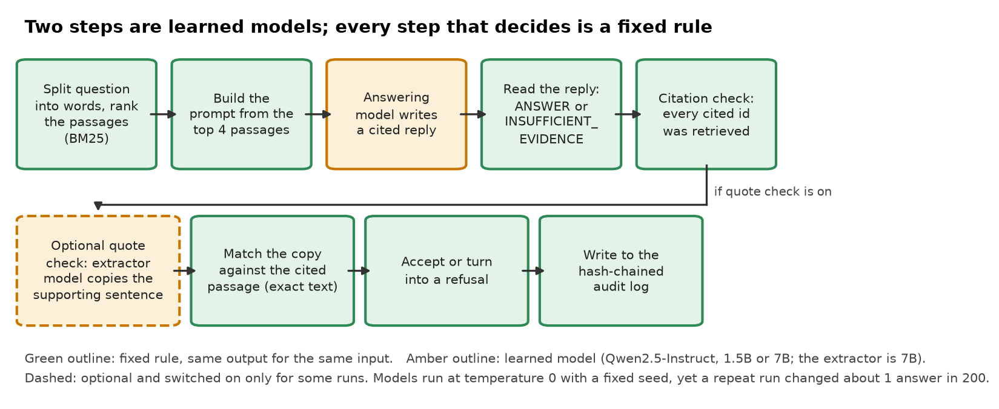
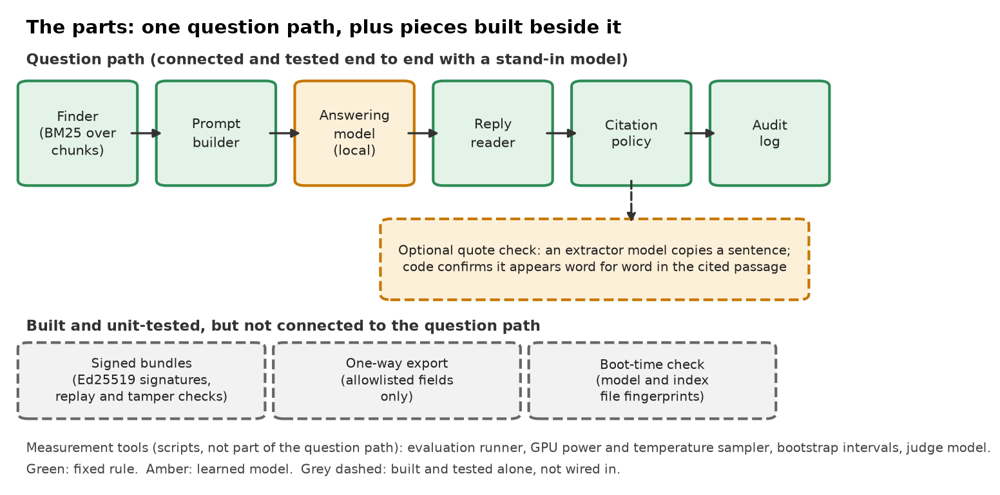
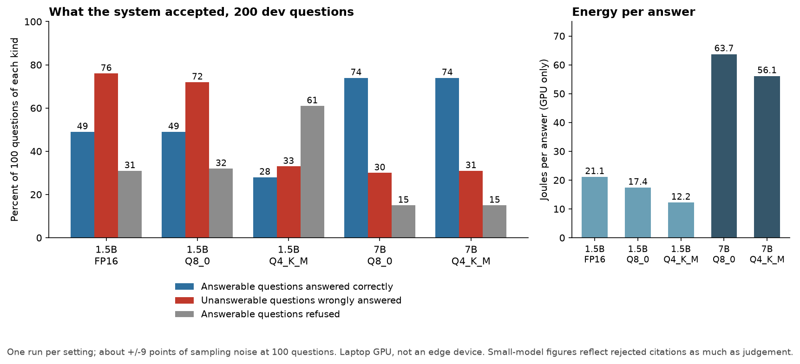

# TriageBox

*A question-answering box for a set of documents that runs a small AI model on the machine itself and refuses any answer that does not cite one of the passages it was shown.*

Status: a measured research prototype, last changed in October 2026. Code: https://github.com/PCSchmidt/triagebox (public, MIT (Massachusetts Institute of Technology) licence, a permissive open-source licence). It has no stars, no copies made by others, and no outside users that I can show.

Imagine a locked room with no internet connection and a pile of reports. Someone types a question, and a small AI model reads the best-matching passages and answers. The risk is that a small model, asked something the reports do not cover, will often make up an answer anyway. TriageBox measures how often that happens and puts fixed rules around it: the model must cite the passage it used, in a set format, and ordinary code turns any reply that breaks the rules into a refusal. A "small model" here means one with fewer adjustable numbers inside it (its "parameters"), which makes it cheaper to run on a battery-powered device but usually less capable. "Answer quality" means two things read together: how many answerable questions it gets right, and how many unanswerable questions it wrongly answers instead of refusing.

On 200 questions from a public benchmark, the larger of two model sizes (7 billion parameters) answered 74 of 100 answerable questions correctly and wrongly answered 31 of 100 unanswerable ones. A program that refuses everything scores 0 on the second figure and also 0 on the first, so both must be read together. When the project read those 31 cases by hand, about half were actually supported by the cited passage, which puts the real invention rate nearer 14 of 100. That "14" rests on one person doing the labelling, so treat it as an estimate, not a finding.

Here is what is fixed and what is learned. A calculator is deterministic: the same input always gives the same output. A weather forecast is probabilistic: a best guess that can be wrong. TriageBox is mostly calculator with a forecaster inside. Finding passages, reading the reply, checking citations and keeping a log are fixed rules. The answer itself comes from a language model (software trained on huge amounts of text to continue it sensibly), which is the forecaster: it can be wrong in ways nobody wrote down. It is run at its most repeatable setting, yet a repeat run still changed about 1 answer in 200.



One limit matters more than any other, and I say it here and then tell its story once, in the next chapter. The fixed rules check form, not truth. They can confirm that a citation points at a passage the model was shown, but not that the passage answers the question, so the tagline's promise is narrower than it sounds. AI coding agents wrote almost all of the code, and I directed the scope, plan, architecture and preferences.

If you have ten minutes, read this opening and the chapters on what it does, the results, and the one for recruiters and interviewers.

## What problem this solves

Picture an analyst with a laptop and a folder of public reports, somewhere with no network. They ask, "Who owned the trawler?" and a small model answers "Danish", citing the report. The report says the trawler is Danish-flagged, a fact about its flag, not its owner. The answer sounds right, cites a real report, and is wrong, and the fixed rules accept it, because the citation is real. This is the blind spot, which I will call the relevance gap, and the rest of this guide refers back to it. A device with no network or a small power budget cannot call a big cloud model, so people either trust a small one or avoid it.

TriageBox tries a third path: measure honestly how often each model size invents answers, and add cheap checks that reject the worst cases. The stated goal is a measured answer, not a product: for each model size and storage setting, how accurate is it, how often does it answer when it should refuse, and how much energy does one answer cost, in joules (units of energy)? Hoped for but not yet done is the same measurement on an actual edge device (a small, low-power computer meant to run in the field, such as NVIDIA's Jetson Orin Nano) and on the benchmark's held-back test half.

The scope I set is public, unclassified documents only, with no employer or controlled data. The test documents are a public benchmark and fictional reports written for the project in the style of ISR (Intelligence, Surveillance and Reconnaissance) reporting, a field that interests me.

## What it does, step by step

A person types a question. I will use the project's own made-up trawler report as the running example: a patrol boat sighted a fishing trawler drifting with engines stopped near a lighthouse, and "the trawler is Danish-flagged and showed no navigation lights. Three persons were seen on deck."

First, the program splits the documents into chunks (windows of up to 200 words) and ranks them against the question with a standard word-matching formula, keeping the top four. Second, it builds the prompt, which is the full text sent to the model: the four chunks, each labelled with an id like "d13#0", plus strict instructions to reply either "ANSWER: ... [id]" or "INSUFFICIENT_EVIDENCE". Third, the local model replies; for "What flag does the trawler fly?" something like "ANSWER: Danish [d13#0]". Fourth, code reads the reply. It must start with the right tag, carry answer text and cite at least one id, and every cited id must be one of the four chunks shown. Only then is the answer accepted; anything else becomes a refusal. Fifth, every question, reply and decision goes into a log in which each line carries a hash (a short fingerprint) of the previous line, so later editing is detectable.



A fair comparison is a customs officer checking paperwork. The officer cannot tell whether the traveller is honest, only whether the forms are filled in and stamped by a real office. The comparison breaks down because a model can fill in valid forms around a wrong claim, which is the trawler case above.

The realistic users are people who want to study the pattern or run the same measurements on another model. The reader of the answer is the only reviewer, and the project's README (the front-page text file of a repository) says nothing here has been security-reviewed.

## How it works: parts, data and tools

The question path has five parts. The finder ranks chunks. The prompt builder assembles the instructions and passages. The answering model is the one learned part. The reply reader and the citation policy are the fixed rules that accept or refuse. The audit log records everything. An optional sixth, the quote check, adds a second model call and is described below.

Three more modules were built beside this path: signed bundles for updating a disconnected box (using Ed25519, a widely used digital-signature scheme), a one-way export that lets only a short list of fields leave it, and a boot-time check that refuses to start if the model files have changed. Each is implemented and has its own unit tests, but none of them is wired into the question path or the measurement scripts, so together they are parts, not a working disconnected setup. The details, and the licences of the models and data, are in the companion Evidence Notes.

The data is of two kinds. The first is SQuAD 2.0 (the Stanford Question Answering Dataset), a public benchmark built from Wikipedia paragraphs, in which crowd-workers wrote about half the questions to look answerable when the paragraph does not contain the answer. The project uses a subset, split by article into a development ("dev") half used for tuning and a "test" half kept aside and used once, so that nobody tunes on the questions they are graded on. The second is a set of fictional reports with about 60 questions per half, built so that the correct answer or refusal is known exactly. It includes questions answerable from one report, questions that need two near-twin reports compared, and three kinds of unanswerable question, among them a "bait" kind whose answer sits only in the twin report. Neither data set is committed to the repository; a script downloads the benchmark and records its fingerprint.

The tools are few: Python, with one signing library as the only outside package. The language model runs through llama.cpp, an open-source program that runs models on the local machine (here, on a graphics card), from model files in GGUF (a single-file format for storing a model). Retrieval counts words, not meaning, and caps accuracy: the right paragraph is in the top four for 93.7% of the answerable dev questions. The project did not test larger document sets.

## The methods, and why they were chosen

The finder uses BM25 (Best Matching 25), a standard ranking formula that scores a chunk higher when it contains rare question words, and discounts long chunks. A toy example: ask "What flag does the trawler fly?" over three one-sentence chunks, one about the trawler, one about a bulk carrier, one about an air track. Only the trawler chunk contains any question word, "trawler". "Flag" does not match "Danish-flagged", because the finder does no stemming (cutting word endings). The trawler chunk scores 0.90 and the others are dropped, so the right chunk is found, though not because of "flag". A meaning-based alternative, an embedding (a list of numbers that captures what a passage is about), was tested on the dev half. Embeddings alone were worse (the right paragraph in the top four 90.3% of the time against 93.7%), and mixing both was at best slightly better.

The citation policy is the fixed checklist described above. A word-overlap variant, tried offline, removed only 2 of the 14 unsupported answers and cost 5 to 7 points of accuracy, so it is not the default.

The quote check is the project's main idea for the relevance gap. A second model call is asked to copy, word for word, the sentence of the cited passage that states the answer, or reply NONE. Plain code then measures how much of the copy appears verbatim in the cited passage (the longest matching run divided by the quote's length), and keeps the answer only if at least 90% matches. The model only extracts; it cannot talk its way past the string match. Toy example: the real sentence "The trawler is Danish-flagged and showed no navigation lights", copied exactly, scores 1.0; an invented "The trawler is owned by a Danish firm" scores 0.41 and the answer is dropped. The threshold and first prompt were fixed before any results were seen. It does not close the gap: the model can copy the real flag sentence, which scores 1.0, and the check passes an answer to a question about ownership.

The project reports no confidence or probability, so every score is a plain percentage with a stated error range from a bootstrap (re-drawing the questions at random many times to see how much the number moves). With 100 questions of one kind, a rate near 30% moves by about 9 points either way.

## The models: what runs, why, and what it gets wrong

Everything the project measures is a local model run through llama.cpp. No paid or hosted service is called, so there is no per-question fee.

The answering model is Qwen2.5-Instruct, a family of openly released chat models from the Qwen team, used in two sizes, 1.5 billion and 7 billion parameters. It takes in the prompt (instructions, up to four passages, the question) and returns the reply described above. The docs give licence and availability as the reasons; the repository does not say why other open families were not used.

Each size is stored at several precisions, called quantisation: keeping each of the model's numbers with fewer bits so the file is smaller and faster. The names are the settings of the llama.cpp tool. FP16 (16-bit floating point) keeps 16 bits per number; Q8_0 and Q4_K_M keep roughly 8 and roughly 4 (the exact layouts are llama.cpp's own). The 1.5B model is 3.56, 1.89 or 1.12 gigabytes at those settings; the 7B is 8.1 gigabytes at Q8_0 and 4.68 at Q4_K_M. The 7B at FP16 does not fit a 16 GB card and was not run. Every run used temperature 0 (always pick the most likely next word) and a fixed random seed.

The prompt went through four versions, and the story is short. The first version's reply format had a hole: about one reply in eight came back as a citation with no answer text, and an early reader wrongly accepted them, so that hole was closed. The second version added an example, which the small models copied, citing the example's id instead of a real one. The third replaced the example with a placeholder and lifted the 1.5B models' accuracy by 5 to 9 points, though the project calls that suggestive only and it did not help the 7B models. The fourth was worse. The table in the results chapter and the 7B runs use the second version, since the third did not help the 7B models; the third was used for the 1.5B models in the fictional-report test run.

The quote check's extractor is Qwen2.5-7B at Q8_0. It is sometimes too strict, replying NONE for an answer plainly in the passage, so a correct answer is lost.

The project also tried a faithfulness judge: a model shown the question, the answer and the cited passage and asked whether the passage supports the answer. Judges built on Qwen2.5-7B and on Phi-3-mini (a 3.8-billion-parameter model from Microsoft) agreed with the hand labels only about 70% of the time, one too strict and the other almost never rejecting anything, so neither can be trusted alone.

What the answering models get wrong is the heart of the measurements. The 7B models invent answers to about 30% of near-miss unanswerable questions. The 1.5B models almost never say there is not enough evidence: 90 to 92% of unanswerable questions get an answer, and the better-looking figure for the lowest-precision one comes mostly from the citation policy rejecting broken citations, not from good judgement.

## Edge cases, testing and safeguards

Small bad inputs, tried in a scratch copy of the repository with a stand-in that returns fixed replies, were mostly refused: invented ids, missing citations, malformed tags, empty questions. Tampering with the audit log by editing, reordering or removing a middle entry was caught, and the unwired bundle, export and boot-check modules rejected bad input when tried on their own.

Three things got through, and the project documents all three. A citation to a real but irrelevant passage is accepted, which is the relevance gap. Cutting the end off the audit log cannot be detected from the log alone. And the quote check accepts a real sentence that does not answer the question.

There are 112 automated tests, and all 112 pass on a Windows copy; on the Linux CI machine one fails for the reason given below. They are unit tests (each checks one small piece, using fake models and a fake web server), plus a check that the locked test files have not changed. None runs a real model, and the share of code they reach was not measured. AI coding agents wrote them with the code.

The project's automatic checks (CI (Continuous Integration), a service that runs the tests on every push to GitHub) have been red since the commit that added the locked test files. The cause is small: the lock records a fingerprint that matches the Windows line-ending version of one file, while the stored file has Unix line endings, so the check fails on Linux though the content is the same. It is a repository defect, not evidence that the data changed.

On proving it works on new data: the evaluation protocol is in the first commit, before any result existed, and the fictional set's test half was locked and used once per setting. Only the commit dates show that order, since there is no outside timestamp. The benchmark's own test half has not been used at all.

## Does it work? The results

All figures count what TriageBox accepts after the citation policy: a rejected answer counts as a refusal. Accuracy is the share of answerable questions answered with text containing the correct answer. "Wrongly answered" is the share of unanswerable questions that got an answer instead of a refusal. These come from the benchmark's dev subset of 100 answerable and 100 unanswerable questions, one run per row. Energy is for the graphics card only.

| Model | Accuracy | Wrongly answered | Refused though answerable | Energy per answer |
| --- | --- | --- | --- | --- |
| 1.5B, FP16 | 49% | 76% | 31% | 21.1 J |
| 1.5B, Q8_0 | 49% | 72% | 32% | 17.4 J |
| 1.5B, Q4_K_M | 28% | 33% | 61% | 12.2 J |
| 7B, Q8_0 | 74% | 30% | 15% | 63.7 J |
| 7B, Q4_K_M | 74% | 31% | 15% | 56.1 J |



Three takeaways. First, model size matters far more than precision: shrinking the 7B model from Q8_0 to Q4_K_M changed nothing measurable while saving about 12% of the energy, so the project's reading is that 7B at Q4_K_M is the best setting tested. Second, the 1.5B models invent answers to most unanswerable questions; the 1.5B Q4_K_M row looks safe at 33%, but only because it also refused 61% of answerable questions. Third, the quote check, which takes about two to three times the time and energy per question, cut the 1.5B models' invention on the fictional set to 11% at a cost of up to about 24 points of accuracy, and removed 8 of the 14 unsupported answers on the hand-labelled 7B run while wrongly removing 4 of 17 supported ones.

How to read these numbers: with 100 questions of a kind, differences under about 9 points are noise, so 30% against 31% means nothing. Every number comes from one run per setting on a laptop graphics card, an NVIDIA RTX A4500, not from the small edge device the project is aimed at, and a low-power device could rank the settings differently. The fictional set is small and had its questions written by the same assistant that wrote the reports, so a 90% score on it, with 11% wrongly answered for the 7B models, shows an easy set, not a solved problem. The prompt was tuned on the 7B model using the same dev questions that are reported. The project reports its negative results too: the wrongly-answered figure rose from 23% to 31% once replies were well formed. The numbers in this guide match the saved result files.

## Could it be put into real use?

No. On a scale of experiment, works locally, deployable and operated, it sits at works locally: it runs, has 112 passing tests, and its measurements are recorded. Nothing is hosted and no outside user is known. A real deployment would still need a run on an actual edge device, sign-in and key management, monitoring, a way to roll back and a security review. Three small steps would help most: a run on the edge device, repairing CI, and wiring the bundle, export and boot-check modules into one demo. As a showcase it rates "possible": a study with documented limits.

## Strengths, shortcomings and the work still to do

The project separates what the model said from what the system accepted, reports error ranges, keeps a dev half apart from a locked test half, publishes the failures it hit, and records the prompt version and settings in each result file.

Three shortcomings matter most. The first is the relevance gap described earlier; a question-to-passage check would help but costs more model time. The second is thin evidence for the quote check: 19 hand-labelled unsupported answers from one labeller on the benchmark, and a fictional set for the rest. A second human labeller would help most. The third is the red CI, together with a stale line in one doc saying the quote check is not wired into the pipeline although it now is. The README and roadmap list the edge-device measurements and a disconnected-sync demo as planned, and the roadmap adds a small-model fine-tuning comparison, none started. Whether to finish, freeze or merge the project is not recorded.

## How it was built, and who did what

AI coding agents wrote almost all of the code, and I directed the scope, plan, architecture and preferences. I did not write the code by hand and do not claim to. All 13 commits, made between 16 and 23 October 2026, carry an AI co-author credit, and most are milestones with their result in the message. The work was checked through the tests, the written protocol with its dev and test halves, error ranges and hand labels, and the project's notes record mistakes caught along the way, such as the empty-citation hole and the detector bug. The repository has no instruction file for the agents, so how context was carried between sessions is not recorded.

## For recruiters and interviewers

In thirty seconds: I directed AI coding agents to build a small question-answering box that measures, across five model sizes and precisions, how often a local model invents answers and what each answer costs in energy, with fixed rules rejecting uncited answers. In two minutes, add that a model-based check catches some unsupported answers at a real price in accuracy and time, and that the project documents its own bugs.

It shows evaluation practice (protocol before results, dev and test halves, error ranges), reporting of negative results, hardware measurement, and checks that refuse by default. It does not show real users, teamwork, edge hardware or model training.

| Typical requirement | What the project shows | Strength |
| --- | --- | --- |
| Evaluation of AI output | Metrics, dev and locked test sets, error ranges | Shown, on a small scale |
| Safety controls on AI output | Citation policy and quote check; known relevance gap | Partly |
| Choosing models and trade-offs | Size and precision ladder with energy | Shown, laptop only |
| Deployment and monitoring | Local runs, audit log, no hosting | Not shown |

The strongest role family is the ML or AI engineer with an MLOps (Machine Learning Operations, running trained models reliably in production) flavour, because of the quantisation and hardware measurements, then the applied language-model engineer. The weakest is a forward-deployed role (an engineer who builds for a customer on site), since nothing was built for a customer; of my target titles, AI Engineer fits better than Forward Deployed AI Engineer.

Questions I would expect:

- **How do you know the numbers are right?** The protocol and result files are in the repository; small differences are noise.
- **If the AI wrote the code, what did you do?** Scope, plan, architecture and preferences.
- **Have you run this for real users?** No.
- **What would you change first?** Measure on an actual edge device.

What not to claim: that the checks guarantee true answers, that the energy figures describe an edge device, or that the fictional-report results say anything about real reports.

## Glossary

- **Hallucination:** here, answering an unanswerable question instead of refusing.
- **Quantisation:** storing a model's numbers with fewer bits to shrink it and speed it up.
- **Chunk:** a window of up to 200 words from a document.
- **Dev and test halves:** questions used for tuning, and questions set aside and used once.
- **Hash:** a short fingerprint of some text that changes if the text changes.
- **Bootstrap:** re-drawing the questions at random many times to see how much a score moves.
- **CI:** automatic tests that run on every push to a repository.
- **Joule:** a unit of energy; one watt for one second.

## Where to look in the code

```text
triagebox/
  src/triagebox/   retrieval, prompt, citations, pipeline, audit, bundle, diode, integrity, verify, metrics
  scripts/         evaluation runner, ladder timing, retrieval and detector studies
  eval/isr/        the fictional reports, questions and the lock file
  docs/            protocol, data, results, ladder, faithfulness, detector, roadmap
  results/         saved result files for every run
  tests/           the 112 tests
```

The program's main entry is the triage function in `src/triagebox/pipeline.py`; start there, then `prompt.py`, `citations.py`, `rag.py` and `verify.py`. Install and test with `pip install -e ".[dev]"` and `pytest`. Running the measurements needs a local llama.cpp server and downloaded model files.
